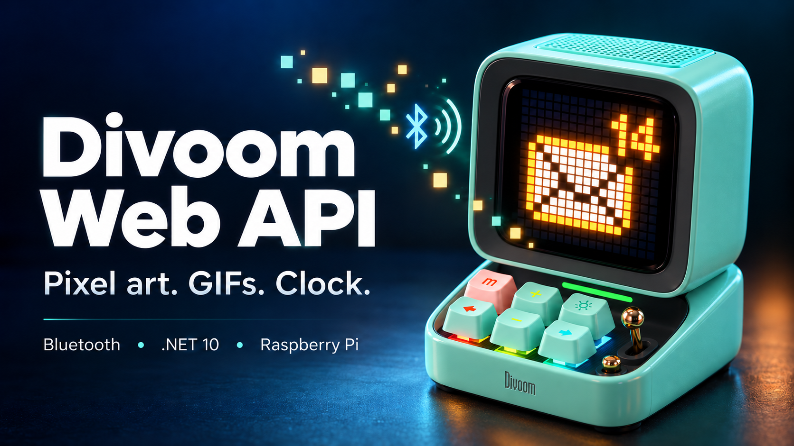

# Divoom Web API



Authenticated Web API for the Divoom Ditoo Pro: images, looping GIF animations
and date/time over Bluetooth. Supports Windows BLE and Linux BlueZ, including
Docker on Raspberry Pi. Optional Windows and Linux audio playback accepts trusted online
stream URLs and plays them through an explicitly configured audio output.
`Divoom.Api` is the application entry point;
`Divoom.Client` can also be used directly from .NET applications.

## Contents

- [Projects and architecture](#projects-and-architecture)
- [Build and test](#build-and-test)
- [Linux host setup](#linux-host-setup)
- [Raspberry Pi and Docker](#raspberry-pi-and-docker)
- [Run without Docker](#run-without-docker)
- [HTTP API](#http-api)
- [Configuration](#configuration)
- [Audio playback](#audio-playback)
- [Client API](#client-api)
- [Linux transport](#linux-transport)
- [References and licenses](#references-and-licenses)

## Projects and architecture

- `Divoom.Api`: routing, authentication, validation, configuration and a shared
  `IDittoProClient` for the host's lifetime. Operations live in `Endpoints`.
- `Divoom.Client`: protocol, acknowledgements, initialization, lazy connection,
  session reuse and disposal through `IDittoProTransport`, plus managed
  PNG/JPEG/BMP/GIF decoding and resizing to 16x16.
- `Divoom.Audio`: portable audio player contracts and session lifecycle, separate
  from the BLE display protocol. Windows MediaPlayer and Linux mpv backends live in their respective transports.
- `Divoom.Transport.Windows`: Windows GATT/RFCOMM channels and discovery.
- `Divoom.Transport.Linux`: BlueZ BLE/GATT channel through host system D-Bus, and mpv/PulseAudio playback.
- `Divoom.Client.Tests`: protocol, media, lifecycle and local D-Bus tests.
- `Divoom.Api.Tests`: HTTP authentication, validation, errors, lifetime and Kestrel tests.

Source projects are under `src/`; sample media are under `assets/`.
`Divoom.Client` includes `DittoMedia` and the StbImageSharp dependency for
portable file and stream decoding.

One `IDittoProClient` lives for the API host's lifetime. It connects lazily,
serializes device operations and reuses its session. Stopping the API disposes
the client and transport. HTTP routing stays in `Divoom.Api`, while protocol
and connection logic live in the client and transports.

The portable API target `net10.0` uses Linux BlueZ. On Windows, use the
`net10.0-windows10.0.19041.0` target to select `WindowsBleTransport`.
The client and Linux transport also target `net10.0` and support Linux ARM64.

## Build and test

Install .NET SDK 10 and run these commands from the repository root.
The NUnit test projects run with `dotnet test` and support IDE test discovery.

```powershell
dotnet build src/Divoom.slnx -c Release
dotnet test src/Divoom.Client.Tests/Divoom.Client.Tests.csproj -c Release
dotnet test src/Divoom.Api.Tests/Divoom.Api.Tests.csproj -c Release
```

Client tests cover protocol vectors, media decoding, connection lifecycle and
an actual local D-Bus server over loopback TCP. API tests use a fake device
client and cover authentication, uploads, limits, errors, singleton disposal
and a real Kestrel listener. Automated tests do not require Bluetooth hardware.

## Linux host setup

Use a 64-bit Raspberry Pi OS with Bluetooth enabled and BlueZ running on the
host. Select the Ditoo **Light** endpoint. Replace `AA:BB:CC:DD:EE:FF` in the
examples below with its MAC address. The transport looks up the MAC address
on the specified adapter and starts a bounded discovery session if it is unknown.
It stops its own discovery session after finding the device or on failure.

```sh
sudo systemctl enable --now bluetooth
bluetoothctl show
```

If GATT reports an authentication error or service resolution times out, pair
the device on the host. Release any phone connection first. Start an interactive
`bluetoothctl` session and enter:

```text
agent NoInputNoOutput
default-agent
pair AA:BB:CC:DD:EE:FF
trust AA:BB:CC:DD:EE:FF
quit
```

Wait for `Pairing successful` before quitting. The agent is needed during initial
pairing; the host keeps the resulting bond for later container connections.
For a different adapter, set `DIVOOM_ADAPTER=hci1`. To keep the selection stable
when adapter indexes change after reboot, use its controller MAC address from
`bluetoothctl list`, for example `DIVOOM_ADAPTER=00:1A:7D:DA:71:11`.

## Raspberry Pi and Docker

After publishing the image with [GitHub Actions](#publish-to-docker-hub-with-github-actions)
and setting up host Bluetooth, copy [docs/compose.yaml](docs/compose.yaml) to
the Pi as `compose.yaml`. With Docker
Compose installed, run from the directory containing that file:

```sh
export DIVOOM_ADDRESS=AA:BB:CC:DD:EE:FF
export DIVOOM_API_KEY="$(openssl rand -hex 32)"
export DIVOOM_IMAGE=panfilenok/divoom-ditto-pro-client:latest

docker compose pull
docker compose up -d
```

Keep the generated key for HTTP requests. You can also store these variables
in a local `.env` file for Compose. Changing the key requires recreating the
container. `DIVOOM_PORT` sets the published host port (default 8080). Compose
publishes it on the host's network interfaces. For Internet access, use an
HTTPS reverse proxy to encrypt the key in transit.

GitHub Actions uses the root `Dockerfile` to build `Divoom.Api` and publish it
to Docker Hub. The Pi pulls the image without compiling the application.
The .NET 10 images support ARM64 on 64-bit Raspberry Pi OS.
The [Compose example](docs/compose.yaml) mounts `/run/dbus` read-only so the
container can communicate with host BlueZ, and a named volume at `/data`
persists the controller UUID across runs. `TZ` defaults to `Europe/Amsterdam`.

The container runs as root for the default system-bus BlueZ policy. A non-root
deployment needs a corresponding host D-Bus policy. No privileged container,
host networking, USB device mapping or second Bluetooth daemon is required.
BlueZ owns the radio on the host.

### Publish to Docker Hub with GitHub Actions

`.github/workflows/docker-publish.yml` builds a `linux/arm64` image for 64-bit
Raspberry Pi OS using GitHub's native ARM64 runner and the root `Dockerfile`.
It builds the portable API and runs both test projects before building the image.
32-bit Raspberry Pi OS is not supported by this workflow.

Create a Docker Hub repository, then configure these values in your GitHub
repository under **Settings > Secrets and variables > Actions**:

| Kind | Name | Value |
| --- | --- | --- |
| Variable | `DOCKERHUB_USERNAME` | Your Docker Hub login username (`panfilenok`) |
| Secret | `DOCKERHUB_TOKEN` | Docker Hub access token with Read & Write permission for the image repository |
| Variable (optional) | `DOCKERHUB_IMAGE` | Override the full image name; defaults to `panfilenok/divoom-ditto-pro-client` |

The workflow runs on pushes to `main` and tags matching `v*`. To run it manually,
open **Actions > Raspberry Pi Docker image > Run workflow** and select `main`.
Manual runs also support `v*` tags via the GitHub CLI or API; other branches are skipped.
Pushes to `main` publish `latest` and a
`sha-<commit>` tag. Pushing a semantic version tag such as `v1.2.3` publishes
`1.2.3`, `1.2`, and a commit tag; it does not replace `latest`.

On the Pi, run from the directory containing your copied `compose.yaml`,
configure the device address and API key as above, and select the published image:

```sh
export DIVOOM_IMAGE=panfilenok/divoom-ditto-pro-client:latest
docker compose pull
docker compose up -d
```

`DIVOOM_IMAGE` defaults to `panfilenok/divoom-ditto-pro-client:latest`, so setting
it is optional. You can store it in `.env` alongside the other settings. Repeat the
two Compose commands to update the container, or choose a version tag such as
`panfilenok/divoom-ditto-pro-client:1.2.3` to use a specific release.
Containers restart after reboot and log files are limited to three files of 10 MB.

## Run without Docker

Without Docker on Linux, set the same variables and run:

```sh
export DIVOOM_ADDRESS=AA:BB:CC:DD:EE:FF
export DIVOOM_API_KEY="$(openssl rand -hex 32)"

dotnet run --project src/Divoom.Api -f net10.0 -- --urls http://0.0.0.0:8080
```

On Windows, the Windows target selects `WindowsBleTransport` automatically:

```powershell
$env:DIVOOM_ADDRESS = 'AA:BB:CC:DD:EE:FF'
$env:DIVOOM_API_KEY = '<your-api-key>'
dotnet run --project src/Divoom.Api -f net10.0-windows10.0.19041.0 -- --urls http://127.0.0.1:8080
```

Windows state defaults to `%LOCALAPPDATA%\Divoom.Api`; Linux defaults to `/data`.

## HTTP API

For a separate gallery or other network client application, use the standalone
[HTTP client agent guide](docs/http-client-agent-guide.md). It defines the
device integration boundary, request/response contract, and client error handling
without requiring Bluetooth or protocol code in the consuming application.

All API routes, including health, require an `X-Api-Key` header. The API reads the
key from `DIVOOM_API_KEY`. Startup fails if the key or device address is missing.
Run the following examples from the repository root.

### Swagger UI

Open `http://raspberrypi.local:8080/swagger` (or your API host and port) in a
browser. Swagger UI is served by the API in all environments, including Docker;
no separate service or port is needed. On Windows with the command above, open
`http://127.0.0.1:8080/swagger`.

Click **Authorize**, enter your `DIVOOM_API_KEY`, and confirm. Choose an operation,
click **Try it out**, edit the JSON body or select an image/GIF file, then click
**Execute**. Requests send the key in the `X-Api-Key` header. For uploads, select
the matching content type; the file is sent as raw bytes. Start with
`GET /api/health` to check access without connecting to Bluetooth.

The UI, its assets and `/swagger/v1/swagger.json` are publicly readable so the
browser can load documentation before authorization. API operations still require
the key. The documentation contains no configured credentials, and the UI does
not persist authorization across page reloads.

### Requests

| Method | Route | Body |
| --- | --- | --- |
| GET | `/api/health` | None; API liveness without Bluetooth connection |
| POST | `/api/images` | Raw PNG, JPEG, BMP or GIF bytes (first GIF frame) |
| POST | `/api/animations` | Raw animated GIF bytes |
| POST | `/api/display/clock` | Optional JSON: {"style":0,"color":"#00FF00"}; no body uses these defaults |
| POST | `/api/time/current` | None; current time in configured `TZ` |
| POST | `/api/time` | JSON: `{"value":"2026-10-06T12:34:56+02:00"}` |
| PUT | `/api/audio/playback` | JSON: `{"url":"https://ice5.somafm.com/groovesalad-128-mp3","volume":0.25}`; start or replace audio |
| GET | `/api/audio/playback` | No body; current audio state |
| PATCH | `/api/audio/playback` | JSON: `{"volume":0.15}`; volume 0..1 |
| DELETE | `/api/audio/playback` | No body; stop audio |

Uploads use raw file bytes, not multipart form data. Set `Content-Type` to the
image MIME type or `application/octet-stream`. Images resize to 16x16; GIF frame
delays are preserved. The key is accepted only in the header, never in the URL.

To switch displays, upload an image or animation, or call `/api/display/clock`.
Clock selection accepts an optional JSON body with `style` (integer 0..15) and
`color` (RGB hex string `#RRGGBB`, case-insensitive). Omitted fields default to
style `0` and green `#00FF00`. Existing requests without a body remain supported;
the success response is unchanged. Invalid settings return HTTP 400 before sending
device commands. Style `14` produced a blank screen during local testing.
Clock selection returns `{"status":"sent","mode":"clock"}` after device
acknowledgement. It does not set the time or change the power-on default mode.
The `/api/time` endpoints synchronize time without selecting the clock display.
To return to an image or animation after showing the clock, resend its file.
Previously uploaded device slots and persistence are not assumed.

```sh
API=http://raspberrypi.local:8080
curl --fail-with-body -H "X-Api-Key: $DIVOOM_API_KEY" "$API/api/health"

# Animated envelope with the number 14
curl --fail-with-body -X POST \
  -H "X-Api-Key: $DIVOOM_API_KEY" -H "Content-Type: image/gif" \
  --data-binary @assets/mail-14.gif "$API/api/animations"

curl --fail-with-body -X POST \
  -H "X-Api-Key: $DIVOOM_API_KEY" -H "Content-Type: image/png" \
  --data-binary @assets/demo.png "$API/api/images"

curl --fail-with-body -X POST \
  -H "X-Api-Key: $DIVOOM_API_KEY" "$API/api/time/current"

curl --fail-with-body -X POST \
  -H "X-Api-Key: $DIVOOM_API_KEY" "$API/api/display/clock"

curl --fail-with-body -X POST \
  -H "X-Api-Key: $DIVOOM_API_KEY" -H "Content-Type: application/json" \
  --data '{"value":"2026-10-06T12:34:56+02:00"}' "$API/api/time"
```

Display/time success: HTTP 200, JSON `{"status":"sent"}`. Image responses also include
`width`/`height`; animation responses include `frames`. This means the client
completed the acknowledged operation, not visual inspection of the display.
Health returns `{"status":"ok"}`.
Audio start instead returns HTTP 202 and a `Location: /api/audio/playback` header;
audio commands/status return the playback state described below.

Errors use Problem JSON: 401 for absent/invalid keys, 400 for invalid input,
413 for bodies over 2 MiB, 415 for unsupported media types, 503 for unavailable
Bluetooth/audio output and 504 for timeouts. Responses omit private transport exception
details. Input images have a 1,048,576-pixel limit per frame; animations also
obey the client's native upload size limit. Display/time operations have a 180-second deadline
and cancel when the request aborts or the host stops.

## Configuration

| Variable | Default / purpose |
| --- | --- |
| `DIVOOM_IMAGE` | Compose image and tag; defaults to `panfilenok/divoom-ditto-pro-client:latest` |
| `DIVOOM_API_KEY` | Required API key |
| `DIVOOM_ADDRESS` | Required Light endpoint MAC address |
| `DIVOOM_PORT` | 8080; Compose host port |
| `DIVOOM_ADAPTER` | `hci0`; accepts an adapter index or controller MAC address |
| `TZ` | `Europe/Amsterdam` |
| `DIVOOM_STATE_DIRECTORY` | `/data` |
| `DBUS_SYSTEM_BUS_ADDRESS` | `unix:path=/run/dbus/system_bus_socket` |
| `DIVOOM_AUDIO_DEVICE` | Windows render endpoint ID/name or Linux PulseAudio sink name; unset disables audio |
| `DIVOOM_AUDIO_ALLOWED_HOSTS` | Comma-separated trusted stream hostnames; required to accept audio URLs; no wildcard or implicit defaults |
| `DIVOOM_AUDIO_AUTO_RECONNECT` | `true` (default) retries interrupted streams; `false` restores terminal failure behavior |
| `DIVOOM_AUDIO_BLUETOOTH_ADDRESS` | Linux only: optional MAC of the already paired audio device for A2DP recovery; may differ from `DIVOOM_ADDRESS`; uses `DIVOOM_ADAPTER` and the host D-Bus |
| `PULSE_SERVER` | Linux only: PulseAudio/PipeWire socket address when outside the host user's normal session |

Each HTTP display/time operation has a 180-second deadline shared by all retry
attempts. Operations cancel when the request aborts or the host stops.
Bluetooth I/O failures and timeouts retry up to three total attempts, waiting
one second after disconnecting between attempts. Each retry reconnects and
resends the entire operation; a lost acknowledgement may cause duplicate
delivery. Cancellation stops retries.
These deadlines/retries apply to display and time commands. Audio commands have
a separate 15-second command deadline and a 20-second playback startup deadline.

## Audio playback

### Windows audio

Pair **DitooPro-Audio** through **Windows Settings > Bluetooth & devices** and
connect it before starting playback. Pairing is an OS provisioning step; the API
does not pair/unpair devices, change the system default output, or fall back to
another speaker. `DIVOOM_ADDRESS` still identifies the **Light** display endpoint.
Audio uses the separately configured Windows render endpoint, not that BLE address.

For example, with this Windows render endpoint name:

```powershell
$env:DIVOOM_AUDIO_DEVICE = 'Headphones (DitooPro-Audio)'
$env:DIVOOM_AUDIO_ALLOWED_HOSTS = 'ice5.somafm.com'
# Set DIVOOM_ADDRESS and DIVOOM_API_KEY as in Run without Docker.
dotnet run --project src/Divoom.Api -f net10.0-windows10.0.19041.0 -- --urls http://127.0.0.1:8080
```

Use the exact name shown by Windows on your system, or its audio endpoint ID.
An absent, disabled, or ambiguous output enters recovery by default (503 when
recovery is disabled); the player never silently selects the default speaker.
Music uses the A2DP output. Opening the
Ditoo microphone can switch to the lower-quality hands-free audio profile.
This version does not expose microphone capture or simultaneous music/capture.

```powershell
$audioHeaders = @{ 'X-Api-Key' = $env:DIVOOM_API_KEY }
$audioApi = 'http://127.0.0.1:8080/api/audio/playback'
Invoke-RestMethod -Method Put -Uri $audioApi -Headers $audioHeaders `
    -ContentType 'application/json' `
    -Body '{"url":"https://ice5.somafm.com/groovesalad-128-mp3","volume":0.25}'
Invoke-RestMethod -Uri $audioApi -Headers $audioHeaders
Invoke-RestMethod -Method Patch -Uri $audioApi -Headers $audioHeaders `
    -ContentType 'application/json' -Body '{"volume":0.15}'
Invoke-RestMethod -Method Delete -Uri $audioApi -Headers $audioHeaders
```

Supply a **direct HTTPS audio stream** URL, not a station's HTML page or playlist
file. MP3 radio streaming has been tested with Windows MediaPlayer and Linux mpv on Ditoo;
other formats/stations need verification. Initial URLs must use port 443, match
an exact configured hostname, contain no URL credentials or fragment, and be at
most 2048 characters. Invalid URLs/volume return HTTP 400 before opening audio.
Only configure trusted station providers: the platform media engine handles
redirects and referenced media internally, and the host allowlist checks the
initial URL only. It is not a network sandbox for an untrusted media provider.
The device API key is never forwarded to the station.

One stream can play at a time. A different URL replaces it; the same URL updates
volume without restarting an active stream. Omitted start volume defaults to
0.25. Volume is player gain (0..1), not a change to system-wide volume. Playback
continues after the start HTTP request completes. By default, interrupted or ended
streams and startup timeouts trigger recovery of the same URL and latest volume.
Recovery continues until DELETE, replacement or application shutdown. Retries wait
2, 5, 10, 30, then 60 seconds between attempts; each preparation and playback startup
has a 20-second deadline. Successful playback resets the backoff. The URL is retained
only in memory, so restarting the API does not resume a station. After receiving
202, poll GET for state:

```json
{"state":"playing","volume":0.25,"error":null,"retryAttempts":0,"lastError":null}
```

States are `stopped`, `starting`, `buffering`, `playing`, `reconnecting`, `failed`, and
`unavailable`. `retryAttempts` counts recovery attempts for the selected station;
`lastError` retains the most recent stable recovery error even after playback resumes.
Errors are stable codes: `startup_timeout`, `stream_failed`, `output_unavailable`,
`audio_not_configured`, or `platform_unsupported`; platform exceptions and source
URLs are omitted from status. `playing` is reported by the media backend; it does not
prove that the physical speaker is audible.

An initially absent output accepts the station with HTTP 202 and `reconnecting`.
An unsuccessful replacement preserves an existing active station and returns 503.
Set `DIVOOM_AUDIO_AUTO_RECONNECT=false` to disable recovery: missing outputs then
return 503 and stream failures remain terminal. `AUDIO_RECOVERY` logs record state,
attempt count and stable error codes, without the URL or credentials. PATCH updates
the desired volume during recovery; DELETE cancels pending connection and retry work.

Audio is optional. Unset `DIVOOM_AUDIO_DEVICE` reports `unavailable` and valid
start/volume commands return HTTP 503, while display commands remain available.

### Linux and Raspberry Pi audio

The portable API uses **mpv** and an explicitly selected PulseAudio sink; a
PipeWire host with `pipewire-pulse` is supported. BlueZ pairing and the audio
server run on the host. The container image includes mpv but does not start an
audio server. Mounting the BlueZ D-Bus alone is insufficient for audio.

On Debian 13, install and enable host audio as the login user that will own the
audio server:

```bash
sudo apt-get update
sudo apt-get install --no-install-recommends pipewire pipewire-pulse wireplumber libspa-0.2-bluetooth pulseaudio-utils
sudo loginctl enable-linger "$(id -un)"
mkdir -p ~/.config/wireplumber/wireplumber.conf.d
cat > ~/.config/wireplumber/wireplumber.conf.d/51-divoom-headless.conf <<'EOF'
wireplumber.profiles = {
  main = {
    monitor.bluez.seat-monitoring = disabled
  }
}
EOF
systemctl --user enable --now pipewire.socket pipewire-pulse.socket wireplumber.service
systemctl --user restart wireplumber
```

The WirePlumber setting permits Bluetooth audio in a headless user session
([Bluetooth configuration](https://pipewire.pages.freedesktop.org/wireplumber/daemon/configuration/bluetooth.html)).
Release DitooPro-Audio from other computers/phones and enable pairing. Use
`bluetoothctl` to pair/trust it and connect Audio Sink. Replace the example address
below with the address discovered for **DitooPro-Audio**:

```text
agent NoInputNoOutput
default-agent
scan bredr
pair AA:BB:CC:DD:EE:FF
trust AA:BB:CC:DD:EE:FF
connect AA:BB:CC:DD:EE:FF 0000110b-0000-1000-8000-00805f9b34fb
scan off
quit
```

Run `pactl list short sinks` and use the exact `bluez_output...` name for
`DIVOOM_AUDIO_DEVICE`. Run `pactl list cards` to confirm an A2DP profile; a
hands-free profile gives lower-quality audio. Sink names can change after a
profile change: update configuration and restart the API. `auto`, `default`,
and symbolic default sinks are rejected. An absent sink enters recovery by default.

For automatic Bluetooth reconnection, set `DIVOOM_AUDIO_BLUETOOTH_ADDRESS` to the
audio device MAC discovered above. Recovery resolves the configured adapter on each
attempt and calls BlueZ `ConnectProfile` for Audio Sink only, then waits for the
exact configured Pulse sink. The device must already be paired on that adapter;
the API does not pair, trust, scan, disconnect the BLE session, reset USB or restart
BlueZ/PipeWire/WirePlumber. Without this setting it only waits for the audio output
to return and reopens the stream. A stuck host audio service or a changed sink name
may still require operator intervention. Windows recovery reopens the configured
render endpoint; Windows owns Bluetooth reconnection.

For a non-container API, also install `mpv`, set the two audio variables, and
run the portable `net10.0` target. It must reach the host Pulse server; set
`PULSE_SERVER=unix:/run/user/1000/pulse/native` when needed (adjust the UID).

For Docker, copy the normal [Compose example](docs/compose.yaml) to the Pi and
add these entries to its existing service's `environment` and `volumes`:

```yaml
    environment:
      # Keep the existing address, API key and other settings.
      DIVOOM_AUDIO_DEVICE: ${DIVOOM_AUDIO_DEVICE:?Set the exact Bluetooth sink name}
      DIVOOM_AUDIO_ALLOWED_HOSTS: ${DIVOOM_AUDIO_ALLOWED_HOSTS:?Set trusted station hosts}
      DIVOOM_AUDIO_AUTO_RECONNECT: ${DIVOOM_AUDIO_AUTO_RECONNECT:-true}
      DIVOOM_AUDIO_BLUETOOTH_ADDRESS: ${DIVOOM_AUDIO_BLUETOOTH_ADDRESS:-}
      PULSE_SERVER: unix:/run/divoom-pulse/native
    volumes:
      # Keep the existing D-Bus mount and state volume.
      - ${DIVOOM_PULSE_DIRECTORY:-/run/user/1000/pulse}:/run/divoom-pulse:ro
```

Set `DIVOOM_AUDIO_DEVICE`, `DIVOOM_AUDIO_ALLOWED_HOSTS`, and optionally
`DIVOOM_AUDIO_BLUETOOTH_ADDRESS` in the Pi's `.env`
alongside `compose.yaml`. Set the Compose-only `DIVOOM_PULSE_DIRECTORY` there
to the host audio user's socket directory if its UID is not 1000. Find it with
`echo "/run/user/$(id -u)/pulse"` as that user, and check that
`test -S /run/user/$(id -u)/pulse/native` succeeds before starting the container.
Then use the normal Docker Hub pull/up commands.
The shown socket setup was verified with PipeWire and the service's root
container user. Other PulseAudio server policies may require additional
socket authentication. Do not expose the Pulse server over TCP.

The Linux player controls its own mpv process through a private Unix socket,
waits for audio initialization before reporting `playing`, and terminates that
process on stop, failure, replacement or shutdown. It disables null-output
fallback and requests PipeWire not to move the stream when its sink disappears.
TLS certificate verification is explicitly enabled. The mpv environment retains
only selected audio/session, proxy, locale and certificate settings, excluding
the API's configuration and key. The process still runs with the API's user
permissions; this is not a media-process sandbox.

## Client API

Portable .NET 10 client for the Divoom Ditoo Pro BLE display endpoint.
The library includes portable image/GIF decoding through StbImageSharp and
accepts file paths or streams through `DittoMedia`.


### Connection lifecycle

The first send method connects and initializes the device lazily. Successful
operations share this connection and session until `DisposeAsync`, which
disconnects and disposes the owned transport. Concurrent operations are
serialized; sequence numbers and image counters continue within the session.
Disposal delegates to the transport's `DisposeAsync`, which owns disconnecting
and releasing its resources; the client does not issue a second disconnect.
All methods accept cancellation tokens. A failed or cancelled in-flight
operation closes the uncertain session. Bluetooth I/O failures and timeouts
automatically retry the complete operation, with at most three total attempts
and a one-second pause after cleanup between attempts. Each retry reconnects
and initializes a new session; partial animations restart from the beginning.
The final failure is propagated. Cancellation and invalid input are not retried;
cancellation also interrupts the retry delay. Cancellation before an operation
starts preserves the existing connection. A lost acknowledgement can cause
content that was already accepted to be sent again.

`CheckConnectionAsync` is private and reserved for future client self-diagnostics.
Connection checks are not exposed through the public client API.
An internal successful connection check also keeps the channel open until disposal.

### Media and protocol behavior

`DittoMediaPreparation` exposes offline quantized previews and prepared image/
animation sizes. Applications do not access the internal wire codec.

Current time is sampled after initialization through `TimeProvider`, then
converted to `TimeZone` (host local by default). Initialization sends JSON
SetUTC and binary time synchronization. `SendDateTimeAsync(DateTimeOffset)`
can send an explicit wall-clock value. Host NTP synchronization is not verified.
The binary year fields are `year % 100` and `year / 100` (decimal century).

`ShowClockAsync` sends the BLE clock settings command
(`45 00 01 STYLE 01 00 00 00 RR GG BB`) and waits for
its sequence acknowledgement. The existing cancellation-token overload defaults
to style `0` and green `#00FF00`; the new overload accepts style and RGB color.
The command uses 24-hour format and disables weather, temperature and calendar.
In local testing on 2026-10-10, the user confirmed green digits on a dark background
with style `0`. Rendering and persistence of other combinations are not guaranteed.
It selects the live display independently of
time synchronization and does not change the startup channel. Resend an image
or animation to display that content again. Physical rendering is not confirmed
by the acknowledgement.
`TIME_SENT` logs the sampled timestamp. A time-command acknowledgement confirms
receipt; the client does not verify the device clock through readback or visual
inspection.

Images preserve up to 128 colors, quantize larger palettes, and use a rolling
preamble counter. Solid colors use Lighting. A checksum-valid sequence response
confirms image receipt, not rendering. Animation frames have individual 1..65535
ms durations and concatenated AA framing in upload chunks of 256 bytes.
There is no 255-block / approximately 64 KiB cap. The uint16 block index permits
up to 65,536 blocks (16 MiB); this is a representation boundary, not a verified
device capacity. The firmware's actual maximum animation size is unknown.
The 0x8b announce carries the exact uint32 file length; each upload block carries
that length and a uint16 block index. Explicit device start permission is
required before upload. No extra file prefix or commit trailer is sent.
The reserved `slot` argument must be zero. Animation completion means all transport writes
completed; display rendering and power-cycle persistence are not inferred.

### Platform boundary

`IDittoProTransport` handles connection, notification subscription, ordered byte
writes, disconnection and maximum ATT value size. UUIDs are in `DittoProUart`.
The client owns framing, checksums, initialization, pacing, splitting at
`min(138, MaxWriteSize)` and response parsing.

- `Divoom.Transport.Windows` implements Windows GATT, Classic RFCOMM connection
  diagnostics and endpoint discovery. The Web API constructs a transport and
  calls the portable client API.
- `Divoom.Transport.Linux` implements `BlueZBleTransport` through host system
  D-Bus. It resolves the Light UART service, subscribes with `StartNotify`,
  forwards characteristic `Value` changes and writes with ATT response flow
  control. See [Linux host setup](#linux-host-setup).


### Behavior and validation

- Connect waits for `Connected` and `ServicesResolved`, resolves the UART UUIDs
  beneath the selected device's service and installs signal subscriptions before
  calling `StartNotify`. It completes only after notifications are enabled.
- `WriteValue` uses `type=request` for ATT flow control. A UART without the
  `write` flag is rejected rather than silently using unacknowledged writes.
- The negotiated characteristic `MTU`, when exposed by BlueZ, gives a maximum
  write size of `MTU - 3`; otherwise the conservative maximum is 20 bytes. The
  client independently splits packets at a maximum of 138 bytes.
- Notification `Value` arrays are copied; remote disconnect/service invalidation
  or a D-Bus connection error marks the channel unavailable. The client owns
  reconnection and protocol reinitialization after a failure.
- StopNotify, device Disconnect and D-Bus release run on disposal/failure.
  Cleanup uses a separate bounded token after setup cancellation. No protocol
  command or write is automatically retried by this transport.
- Tests run an actual local D-Bus server over loopback TCP, without requiring
  BlueZ hardware. They cover wire types, subscriptions, writes, discovery,
  cancellation, errors, negotiated/fallback MTU, reconnect and idempotent disposal.

## References and licenses

[BlueZ GATT API](https://bluez.readthedocs.io/en/latest/gatt-api/),
[BlueZ Device API](https://bluez.readthedocs.io/en/latest/device-api/),
[BlueZ Adapter API](https://bluez.readthedocs.io/en/latest/adapter-api/),
[Tmds.DBus modelling](https://github.com/tmds/Tmds.DBus/blob/main/docs/modelling.md).

Protocol observations and initialization derive from
[orionparrott/divoom-protocol](https://github.com/orionparrott/divoom-protocol).
The MIT license and dependency notices are included in
[THIRD-PARTY-NOTICES.txt](THIRD-PARTY-NOTICES.txt).
